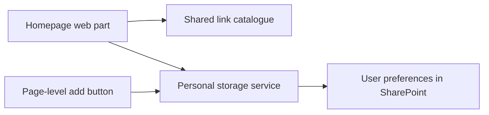

# SharePoint My Favorites Solution

A SharePoint Framework (SPFx) solution that gives users a personal collection of homepage quick links in SharePoint Online. Users can choose links from a shared catalogue, add their own links, and arrange tiles in their preferred order.

The package includes a homepage web part and a page-level add button, backed by SharePoint-native storage.

## Features

- **Personal quick links:** add, edit, remove, and reorder saved links.
- **Shared catalogue:** maintain a common set of available links with descriptions and optional support information.
- **Manual entries:** save custom titles, URLs, and descriptions.
- **Starter links:** provide an initial selection for users who do not yet have saved preferences.
- **Responsive grid:** calculate columns from available space, configure maximum rows, and page through larger collections.
- **Desktop and touch reordering:** drag tiles on desktop or use the touch grip.
- **Draft editing:** apply changes in the Manage panel and save them together.
- **Duplicate checks:** detect repeated links when adding entries.
- **Theme integration:** use shared styling and SharePoint theme values.
- **Optional help link:** configure a how-to page for each homepage web-part instance.

## Web parts

| Component | Purpose |
| --- | --- |
| [MyFavourites](src/webparts/myFavourites/MyFavouritesWebPart.ts) | Displays personal tiles and opens **Manage my homepage quick links**. |
| [AddFavourite](src/webparts/addFavourite/AddFavouriteWebPart.ts) | Saves a configured link or the current SharePoint page to the same personal collection. |

## Technology

| Area | Implementation |
| --- | --- |
| Framework | SharePoint Framework 1.22.2 |
| UI | React 17.0.1 and Fluent UI React 8 |
| Language | TypeScript 5.8 |
| Toolchain | Heft, Webpack, ESLint, and Jest |
| Data access | SharePoint REST through SPFx `SPHttpClient` |
| Storage | SharePoint lists and JSON attachments |

Dependency versions and available commands are defined in [package.json](package.json).

## How it works



One list provides the shared catalogue. Another stores each user's collection as a JSON attachment. The two web parts share the personal storage service.

The storage layer validates saved documents and reports errors instead of treating invalid JSON as an empty collection. Existing attachments are updated in place, and removing a quick link updates the saved collection.

Access is governed by SharePoint permissions. The client-side record checks complement those permissions; they do not replace environment access controls.

### User workflow

1. Open **Manage my homepage quick links**.
2. Choose an available catalogue entry or manually enter a link.
3. Edit, remove, or reorder tiles as needed.
4. Finish or cancel any active entry form, then click **Save** to persist the collection.

Starter links are applied by the homepage when there is no saved preferences file. Later starter changes do not automatically add links to existing saved collections. An intentionally saved empty collection stays empty.

Catalogue-linked favourites keep the user's saved title, URL, and description while resolving catalogue metadata at display time.

## Development

### Requirements

- Node.js **22.22.0**, as pinned in `.nvmrc` and the Volta configuration. The package engine range is `>=22.14.0 <23.0.0`.
- npm and Git.
- A SharePoint Online development environment and an authenticated account.

### Install

```bash
git clone https://github.com/0DmytroPoliak0/sharepoint-my-favorites-solution.git
cd sharepoint-my-favorites-solution
npm ci
```

This repository includes reference environment configuration. Adapt the target configuration and prepare the required SharePoint resources before using it in another environment.

### Run locally

Set the development page in [config/serve.json](config/serve.json) to a suitable SharePoint page in your configured development environment.

```bash
npx heft trust-dev-cert
npm start
```

The certificate command follows the SPFx [development HTTPS setup](https://learn.microsoft.com/en-us/sharepoint/dev/spfx/set-up-your-development-environment#trusting-the-self-signed-developer-certificate). Use the debug-manifest parameters printed by Heft to load the local bundles on the development SharePoint page.

The web parts depend on authenticated SharePoint APIs; the development server is not a standalone version of the application.

### Commands

| Command | Purpose |
| --- | --- |
| `npm start` | Start a clean development build and HTTPS server. |
| `npm run build` | Run the production test/build phase and generate the solution package. |
| `npm run clean` | Clean generated build output. |
| `npx tsc --noEmit --incremental false` | Check TypeScript after project dependencies have been installed. |

### Tests

Tests are located alongside the source and cover:

- Favourite file parsing and serialization.
- Catalogue field resolution and metadata enrichment.
- Duplicate detection and starter selection.
- Grid layout, paging calculations, and reordering.
- User file keys and current-page link resolution.

SharePoint integration and account-access behaviour also need validation in the target environment.

## Build and package

```bash
npm run build
```

The build produces:

```text
sharepoint/solution/myfavourites.sppkg
```

Package metadata is defined in [config/package-solution.json](config/package-solution.json). The current solution package version is **1.0.7.0**.

Deploy the package through your target environment's standard SPFx application process. Installing the package does not automatically create its lists or configure access controls.

The optional how-to link is configured per web-part instance and does not automatically switch destinations when a page is moved between environments.

## Project structure

```text
src/webparts/
  myFavourites/
    components/        Homepage tiles, Manage panel, forms, and paging
    hooks/             Grid measurement and touch reordering
    models/            Favourite and catalogue types
    services/          Storage, catalogue access, helpers, and tests
  addFavourite/        Page-level add button and link-resolution tests
  shared/              Theme handling and shared helpers
config/                SPFx and build configuration
```

## Current limits

- The catalogue reader currently requests up to **500 entries** and does not follow continuation pages.
- Further mobile layout refinement remains follow-up work.
- Migration from the previous document-library storage approach is not automatic.

## Licence

This project is distributed under the [MIT licence](LICENSE). Preserve the existing copyright and licence notices when reusing the source.

## References

- [SharePoint Framework 1.22.2 release notes](https://learn.microsoft.com/en-us/sharepoint/dev/spfx/release-1.22.2)
- [SPFx platform and toolchain compatibility](https://learn.microsoft.com/en-us/sharepoint/dev/spfx/compatibility)
- [Heft documentation](https://heft.rushstack.io/)
